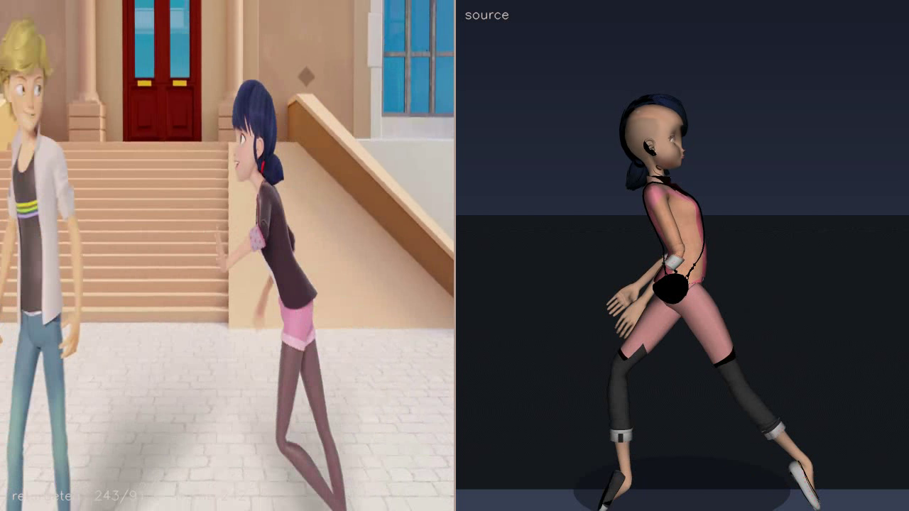

# Roblox-Studio

Asset experiments: motion capture from video, retargeted onto rigged glTF characters.

## What's in here

| Path | What it is |
|---|---|
| `scene 6.glb` | Marinette (Miraculous) character — 25k tris, 134-bone rig, 4 textures, **no animations** |
| `MIRACULOUS … 720p24.mp4` | Season 6 opening (fan-made, old SAMG style), 1280×720, 24 fps, 38.12 s |
| `tools/vid2glb/` | The pipeline that turns video motion into GLB animation |
| `docs/scene6_animated.glb` | **Result** — the character with a full-length run cycle baked in (915 samples, 38.12 s) |
| `docs/scene6_retargeted.mp4` | **Result** — 720p24 side-by-side screen recording, full length |
| `docs/motion/` | Cached landmarks (`tracked_full.json`, `run_roi.json`) and the solved cycle (`run_cycle.npz`) |
| `docs/pose_scan.json` | Per-frame pose landmarks for the whole video (reusable) |

## The result

`docs/scene6_retargeted.mp4` — source footage on the left, retargeted character on the
right, in sync, for all 915 frames:



`docs/scene6_animated.glb` carries the motion as a standard glTF animation
(`retarget_cycle_x915`, 135 channels, 915 samples @ 24 fps), so it plays in three.js,
Babylon, Blender, or any glTF viewer without this toolchain.

## What the source video actually contains

This mattered more than any solver detail. The opening is a **fast-cut montage** —
title cards, extreme close-ups of faces, group wides — and the character is small on
screen. A tracking pass over the whole clip finds a pose in only 503/915 frames.

Exactly one shot shows the whole body in profile and moving: **frames 234–247**, the
girl running across the street. Everything else is a face or a wide shot, where any
"skeleton" the detector reports is noise. So a literal frame-by-frame retarget of the
full 38 s is not possible; what *is* possible is a clean cycle extracted from that one
real stride, played for the full length of the clip.

## How it works

```
video ──► crop + upscale ──► MediaPipe ──► landmarks ──► near-side chain
                                                              │
                                          phase fit + mirror │
                                                              ▼
                              screen recording ◄── raster ◄── symmetric cycle
                                 animated GLB ◄── glTF tracks
```

Three decisions did most of the work:

1. **Crop and upscale before tracking.** The character is ~180 px tall; the pose model
   wants ~400. Re-tracking on a smoothed 2.6× crop lifted detection from 55 % to 93 %
   of the shot and made the wrists and knees usable.

2. **Use only the near side of the body.** In profile, the far arm and leg are
   self-occluded — the detector reports them at ~0.35–0.45 confidence and their angles
   jump by 100°+ between frames. A run is antisymmetric, so the far limb *is* the near
   limb half a stride later, mirrored. Building it that way removes dead limbs and the
   left/right inconsistency, and makes the loop close exactly.

3. **Fit in phase space, not per frame.** Each bone channel is modelled as a few
   harmonics of the stride frequency, so it is periodic by construction — the cycle
   cannot pop at the seam and cannot jitter. An earlier per-frame version, and an
   earlier phase-*binning* version, both flattened the stride to a shuffle.

Plus one animation-principle fix: the head is stabilised against the spine
(`--head-follow 0.25`). Without it a 20° running lean makes the character stare at her
shoes.

No GPU, no OpenGL, no Blender. Rendering is a small C rasterizer loaded via `ctypes`;
glTF reading/writing is `struct` + `numpy`. See
[`tools/vid2glb/README.md`](tools/vid2glb/README.md) for the full write-up.

## Reproduce

```bash
bash tools/vid2glb/setup_tool.sh            # venv + mediapipe + deps (CPU only)
V=/opt/roblox/venv/bin/python
SRC="MIRACULOUS ｜ 🐞 SEASON 6 - OPENING 🐾 ｜ IN OLD SAMG STYLE [FANMADE]-(720p24).mp4"

# 1. track the run shot on an upscaled crop
$V tools/vid2glb/track_roi.py --video "$SRC" --start 195 --end 330 \
      --seed docs/motion/tracked_full.json --out docs/motion/run_roi.json

# 2. one stride -> symmetric loop
$V tools/vid2glb/build_cycle.py --tracked docs/motion/run_roi.json --glb "scene 6.glb" \
      --start 234 --end 247 --near l --frames 10 --harmonics 3 --head-follow 0.25 \
      --out docs/motion/run_cycle.npz

# 3. full-length video + full-length GLB
$V tools/vid2glb/make_video.py --bake docs/motion/run_cycle.npz --glb "scene 6.glb" \
      --source "$SRC" --out docs/scene6_retargeted.mp4 --ssaa 2
$V tools/vid2glb/export_animated_glb.py --glb "scene 6.glb" \
      --bake docs/motion/run_cycle.npz --total-frames 915 --out docs/scene6_animated.glb
```

Inspect a cycle without rendering a video:

```bash
$V tools/vid2glb/render_bake.py --bake docs/motion/run_cycle.npz \
      --glb "scene 6.glb" --grid /tmp/cycle.png
```

## Limits

- The cycle is **derived from one stride**, not tracked per frame, because the video
  only contains one usable stride. Cadence (0.42 s/stride), stride length (0.30 m) and
  left/right symmetry come from measurement; what is *repeated* comes from the loop.
- Bone **twist** is not recovered — it is not observable from sparse landmarks. Limbs
  point the right way but do not roll.
- Upper-arm swing is conservative (~15°): the near arm spends much of the shot folded
  across the chest, so the sagittal signal is small. Elbows carry ~58°.
- The far side is inferred, not observed. If a future clip has both sides visible, pass
  `--near` per limb instead of mirroring.
- 24 fps, 915 frames: pose inference ~0.3 s/frame, render ~0.4 s/frame at 2× SSAA.
